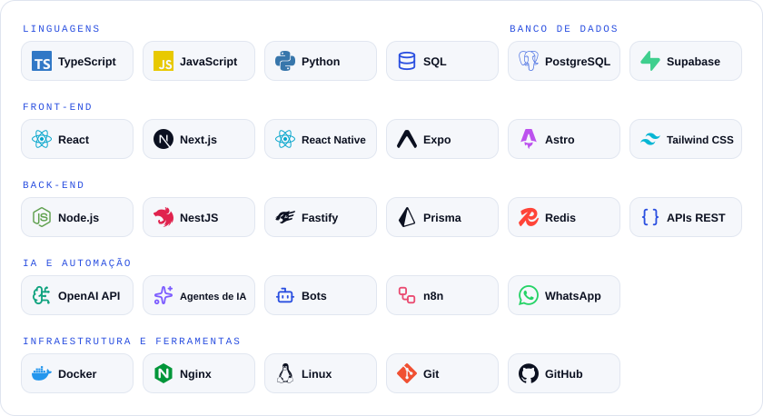
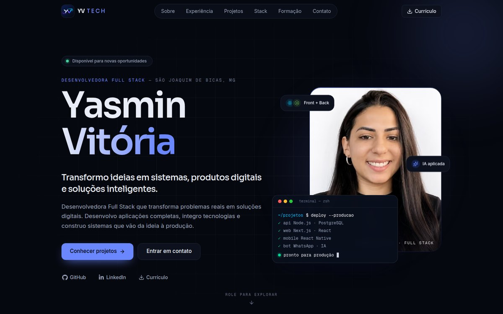

  
  
  
  

## Sobre mim

Sou desenvolvedora Full Stack e transformo problemas reais em soluções digitais. Desenvolvo aplicações completas, integro tecnologias e construo sistemas que vão da ideia à produção.

- 💼 **No trabalho:** participo da criação e da evolução dos sistemas que a empresa usa no dia a dia, do ponto eletrônico ao CRM que acompanha a produção.
- 🚀 **Projetos próprios:** CRMs com atendimento por WhatsApp e Inteligência Artificial, sites, bots e automações.
- 🎓 **Formação:** Análise e Desenvolvimento de Sistemas no Centro Universitário Una, com conclusão prevista para julho de 2027.
- 🟢 **Disponível para novas oportunidades.**

## O que eu construo

<table>
  <tr>
    <td width="50%" valign="top">
      <h3><a href="https://portfolio.yvtech.com.br/projetos/crm-sob-medida">CRMs sob medida</a></h3>
      CRMs completos e adaptáveis a diferentes tipos de negócio: clientes, agenda, retornos, financeiro e atendimento no WhatsApp com Inteligência Artificial.
    </td>
    <td width="50%" valign="top">
      <h3><a href="https://portfolio.yvtech.com.br/projetos/sites-e-aplicacoes-web">Sites e aplicações web</a></h3>
      Sites institucionais, páginas profissionais e aplicações web responsivas, com identidade própria, do layout à publicação.
    </td>
  </tr>
  <tr>
    <td width="50%" valign="top">
      <h3><a href="https://portfolio.yvtech.com.br/projetos/bots-e-agentes-de-ia">Bots e agentes de IA</a></h3>
      Bots para WhatsApp e Telegram e agentes de IA que atendem, agendam e avisam, e sabem a hora de chamar uma pessoa.
    </td>
    <td width="50%" valign="top">
      <h3><a href="https://portfolio.yvtech.com.br/projetos/automacoes-e-integracoes">Automações e integrações</a></h3>
      Fluxos que conectam sistemas, APIs e mensageria para eliminar tarefas manuais e repetitivas.
    </td>
  </tr>
</table>

## Tecnologias

<picture>
  <source media="(prefers-color-scheme: dark)" srcset="assets/tecnologias-escuro.svg">
  <source media="(prefers-color-scheme: light)" srcset="assets/tecnologias-claro.svg">
  
</picture>

## Em destaque

**[Portfólio](https://portfolio.yvtech.com.br)** · [código](https://github.com/yvitoriiaoliveira-hub/portfolio-yasmin)

Feito com Next.js, React, TypeScript, Tailwind CSS e Motion. Tem tema claro e escuro e páginas para cada tipo de projeto. O formulário de contato salva as mensagens em PostgreSQL e me avisa no WhatsApp. Está publicado no meu próprio servidor, com Docker e Nginx, e mede as visitas sem cookies.

## Como eu trabalho

**Entender** → **Estruturar** → **Desenvolver** → **Integrar** → **Publicar**

Converso com quem vai usar para descobrir o problema real. Depois defino as regras de negócio, os dados e o fluxo das telas, construo o back-end, as interfaces e o banco de dados, conecto APIs, mensageria, automações e IA, e por fim testo, documento e coloco em produção.

---

  Vamos conversar? Me chame no <a href="https://www.linkedin.com/in/yasmin-vitoria-23b6a5328/">LinkedIn</a> ou pelo <a href="https://portfolio.yvtech.com.br/#contato">formulário do portfólio</a>.

